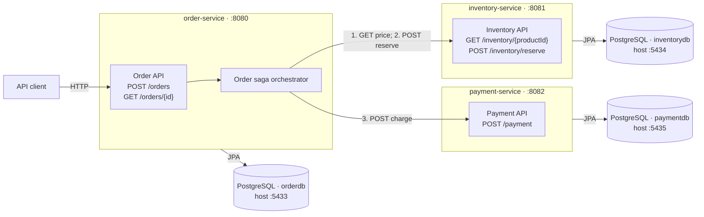

# Mule

Mule is a learning project demonstrating a synchronous, REST-based order saga across three independently deployable Spring Boot services.

The project has three independently deployable Spring Boot applications—`order-service`, `inventory-service`, and `payment-service`—each with its own PostgreSQL database and REST API.

## Overview

Placing an order is a three-step process: `order-service` asks `inventory-service` for item prices, `inventory-service` reserves the requested quantities, and `payment-service` charges the computed total.

## Architecture

The order service is the saga orchestrator and the only entry point for order requests. It synchronously calls inventory to retrieve prices and reserve stock, then calls payment to charge the total. Each service owns a separate PostgreSQL database. Docker Compose starts the databases; the Spring Boot services run as separate processes.



The calls between services are synchronous REST calls; there is no message broker. After the saga completes, the order is stored as `CONFIRMED` or `FAILED`. The three databases are isolated, and the Compose file exposes their PostgreSQL ports on the host as shown above.

## API

| Service | Method | Path | Description |
|---|---|---|---|
| order-service | `POST` | `/orders` | Places an order (single item only). Looks up price, reserves stock, charges payment, in sequence. |
| order-service | `GET` | `/orders/{id}` | Fetches an order by ID. `404` with a structured error body if not found. |
| inventory-service | `GET` | `/inventory/{productId}` | Returns the product's price (and stock). `404` if the product doesn't exist. |
| inventory-service | `POST` | `/inventory/reserve` | Atomically reserves stock. Returns `{"reserved": false}` on insufficient stock — a normal business outcome, not an HTTP error. |
| payment-service | `POST` | `/payment` | Charges an order. Declines any amount ≥ $500 (a deliberate, documented simulation rule, not a real fraud check). |

Example request:
```json
POST http://localhost:8080/orders
{
  "customerId": "customer-1",
  "items": [{"productId": "product-1", "quantity": 1}]
}
```

Example error response (404):
```json
{
  "status": 404,
  "error": "PRODUCT_NOT_FOUND",
  "message": "Product not found: does-not-exist",
  "timeStamp": "2026-10-05T10:00:00Z",
  "path": "/orders"
}
```

A Postman collection covering both the success and insufficient-stock paths is included for manual testing.

## Running locally

Each service needs its own Postgres, via Docker Compose:

```bash
docker compose up
```

Then run all three services, each in its own terminal:

```bash
cd inventory-service && ./mvnw spring-boot:run   # port 8081
cd payment-service   && ./mvnw spring-boot:run   # port 8082
cd order-service     && ./mvnw spring-boot:run   # port 8080
```

`inventory-service` seeds `product-1` (in stock), `product-2` (zero stock), and `product-concurrent` (used by the concurrency test) on startup via `DataSeeder`, idempotently — it checks for an existing row before inserting, since Postgres now persists data across restarts.

API contracts may be redesigned during this split rather than preserving the current MVP's exact request/response shape — documented here explicitly so that isn't a silent, unplanned drift later.